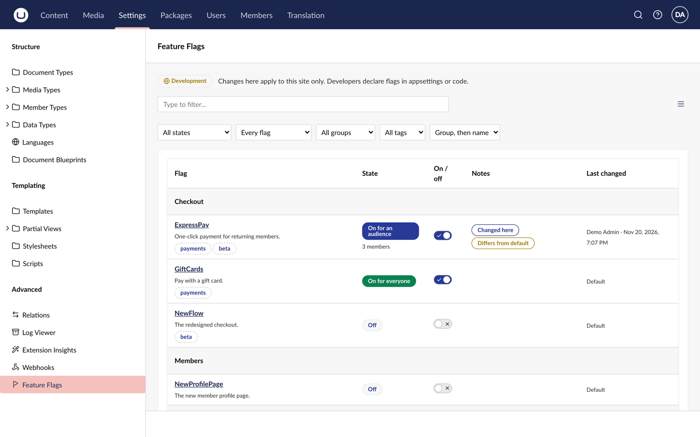
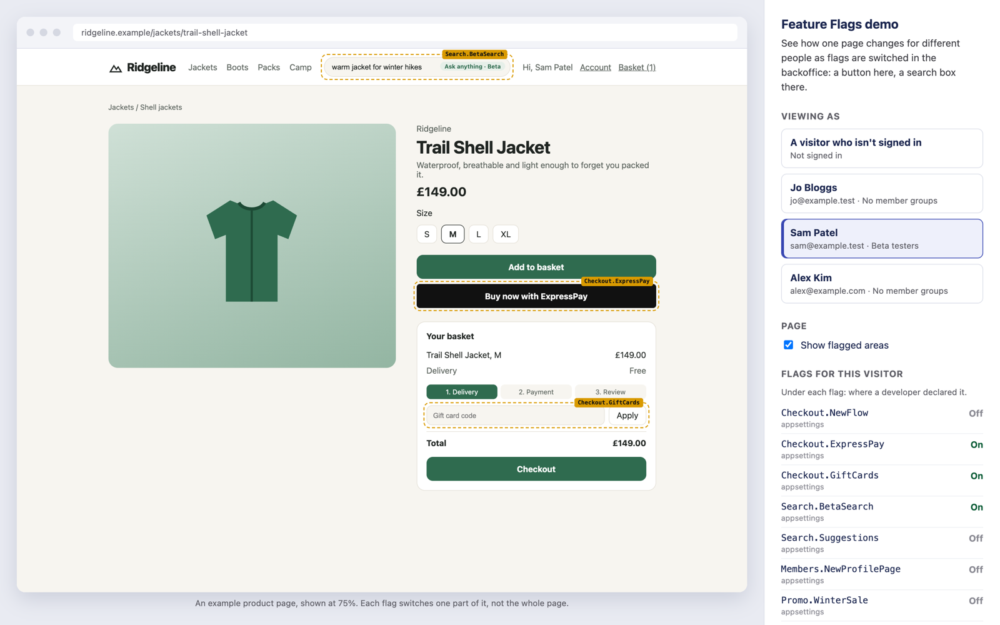

# Umbricians Feature Flags

[](https://www.nuget.org/packages/Umbricians.FeatureFlags)
[](https://github.com/Umbricians/Feature-Flags/actions/workflows/build.yml)

Switch the site's feature flags on and off from the Umbraco backoffice, for everyone or only for chosen members and member groups, built on Microsoft.FeatureManagement. (Umbraco 17.8.0+)

Developers declare flags in appsettings or code and check them with
[Microsoft.FeatureManagement](https://learn.microsoft.com/azure/azure-app-configuration/feature-management-dotnet-reference),
as they would on any ASP.NET Core site. Feature Flags gives editors a screen in Settings to switch each flag off, on
for everyone, or on for an audience of members, member groups and groups the site works out in code. Changes apply
to that site and environment only, reach every server within seconds, and never need a deploy.

A flag doesn't have to switch on a whole new page. It can add one button, swap a search box, or change a price for
the members it is on for.



## Documentation

- **[Getting started](docs/getting-started.md)**: install, declare a first flag, check it, switch it on for an
  audience, and what to check before going live.
- **[Declaring and checking flags](docs/declaring-flags.md)**: appsettings and code, details for editors, and
  checking flags in Razor, controllers and services.
- **[Audiences](docs/audiences.md)**: how members and member groups are matched, group providers, and identifying
  people another way.
- **[Using the backoffice](docs/backoffice.md)**: the guide for editors.
- **[Conditions](docs/conditions.md)**: what a condition is, and registering a rule of your own so the backoffice
  knows it.
- **[Notifications](docs/notifications.md)**: react to, or refuse, a change to a flag's override; audit and
  permission examples.

## Installation

```bash
dotnet add package Umbricians.FeatureFlags
```

Restart the site. No configuration is needed to get started: the package adds Microsoft.FeatureManagement if the site
hasn't, adds its database table, and gives Administrators its permissions.

## Permissions

Set in **Users → User groups → Permissions → Feature Flags**.

| Permission | Allows |
| --- | --- |
| View feature flags | Seeing the flags, their state and who they are on for. |
| Change feature flags | Switching flags on and off, choosing their audience, resetting them to their defaults and removing undeclared flags. Needs View too. |

Administrators get both on install. Other groups get neither until you give it to them.

## Declaring a flag

Flags are declared by developers, because only code can make a flag do something. In appsettings, using Microsoft's
schema:

```json
{
  "feature_management": {
    "feature_flags": [
      { "id": "Checkout.ExpressPay", "enabled": false, "description": "One-click payment." }
    ]
  }
}
```

Or in code:

```csharp
builder.AddFeatureFlags(flags => flags
    .Declare("Checkout.ExpressPay", description: "One-click payment."));
```

New flags should start off. A flag named `Checkout.ExpressPay` is in the backoffice's "Checkout" section. More in
[Declaring and checking flags](docs/declaring-flags.md).

## Checking a flag

With Microsoft's own API. Feature Flags is invisible to code that checks flags.

```cshtml
@addTagHelper *, Microsoft.FeatureManagement.AspNetCore

<feature name="Checkout.ExpressPay">
    <button>Buy now with ExpressPay</button>
</feature>
```

```csharp
if (await featureManager.IsEnabledAsync("Checkout.ExpressPay")) { … }
```

`[FeatureGate("Checkout.ExpressPay")]` on a controller or action works too.

## Who a flag is on for

When a flag is on for an audience, Feature Flags tells Microsoft's targeting who the signed-in member is: their key,
and their member groups by key and by name. A visitor who isn't signed in is only included when a flag is on for
everyone. Sites can add their own groups with a group provider, or replace how people are identified. See
[Audiences](docs/audiences.md).

## Configuration

Everything is optional. Override only what you need in `appsettings.json`:

```json
{
  "Umbricians": {
    "FeatureFlags": {
      "Overrides": "Enabled"
    }
  }
}
```

| Setting | Default | |
| --- | --- | --- |
| `Overrides` | `Enabled` | `Enabled`: editors' settings in the backoffice win over each flag's default. `ReadOnly`: the backoffice shows flags but can't change them, and settings saved earlier are ignored, so the site's flag source, such as appsettings or Azure App Configuration, stays in charge. |

Flags themselves are configured in Microsoft's `feature_management` section, not here.

## Extending

Everything goes through one builder method, in a composer or `Program.cs`:

```csharp
builder.AddFeatureFlags(flags => flags
    .Declare("Checkout.NewFlow", description: "The redesigned checkout.", section: "Checkout", tags: ["beta"])
    .AddGroupProvider<PremiumSubscribers>());
```

`Declare` also takes a Microsoft `FeatureDefinition`, for a flag with filters or variants; see
[Declaring and checking flags](docs/declaring-flags.md#in-code).

| Extension point | Use it to |
| --- | --- |
| `IFeatureFlagGroupProvider` | Put members in groups by a rule of the site's own, such as "premium in the CRM". Editors pick its groups beside member groups. See [Audiences](docs/audiences.md#group-providers). |
| `ITargetingContextAccessor` (Microsoft's) | Identify people some other way than Umbraco members. Register your own and it replaces the package's. |
| `IFeatureFlagCondition` | Tell the backoffice about a feature filter of your own: validate its parameters and summarise it for the list. Register with `AddCondition<T>()`. See [Conditions](docs/conditions.md). |
| `IFeatureFlagService` | Read flags and change their overrides from code, with the backoffice's rules and no permission checks. Change overrides through this; see [Changing flags from code](docs/declaring-flags.md#changing-flags-from-code). |
| `IFeatureFlagOverrideStore` | Keep editors' settings somewhere other than the Umbraco database. Register your own and it replaces the package's. Only for where they are kept: change them through `IFeatureFlagService`, because writing to the store skips the rules and the refresh on other servers. |
| `IFeatureDefinitionProvider` (Microsoft's) | Use your own flag source. Register it before Umbraco is added and Feature Flags puts editors' settings in front of it. |

## API

Feature Flags has a Management API under `/umbraco/umbriciansfeatureflags/api/v1/` that the backoffice uses and your
scripts and CI pipelines can call as an Umbraco API user. See [Calling the API from scripts](docs/api.md) for getting a
token, examples, the endpoints, the status codes and what is promised.

## Licence

[MIT](LICENSE). Copyright (c) 2026 FYIN LLC (trading as Umbricians).

## Development

```
src/Umbricians.FeatureFlags                     the package (Razor class library + Client/ TypeScript)
demo/Umbricians.FeatureFlags.Demo               Umbraco 17.8.0 site on SQLite that references the package
tests/Umbricians.FeatureFlags.Tests             NUnit tests, run with `dotnet test`
tests/Umbricians.FeatureFlags.IntegrationTests  NUnit tests on a real Umbraco and SQL Server; see CONTRIBUTING.md
tests/Umbricians.FeatureFlags.TestSite          the Umbraco site the integration tests start
docs/design.md                                  why the package works the way it does
```

```bash
cd src/Umbricians.FeatureFlags/Client && npm ci && npm run build
```

```bash
dotnet run --project demo/Umbricians.FeatureFlags.Demo
```

The demo runs on https://localhost:44301. The backoffice only accepts logins over HTTPS, so if you pass your own
`--urls`, include an `https://` one. The demo's test admin
login is in `demo/Umbricians.FeatureFlags.Demo/appsettings.Development.json`. Run `npm run watch` in `Client/` while
working on the backoffice, and `npm test` there for its tests.

The demo also has a page at `/flags`: an example shop shown at 75%, with buttons to sign in as each test member, so
you can see what one page looks like to each person as flags change. Its flags are in the demo's `appsettings.json`
and `DemoFlags/DemoFlagsComposer.cs`, and its members in `appsettings.Development.json`.



> The backoffice caches its bundle by the package's version, which is `0.0.0` in a local build, so a browser can keep
> serving an old bundle after you rebuild. Stamp a new local version after each build, then restart the demo:
>
> ```bash
> node build/stamp-version.mjs src/Umbricians.FeatureFlags/wwwroot/App_Plugins/UmbriciansFeatureFlags/umbraco-package.json 0.0.0-local.$(date +%s)
> ```

> The demo reads `appsettings.{environment}.json`. If your machine sets `DOTNET_ENVIRONMENT` (for example to
> `Local`), that overrides the launch profile's `Development`, so the demo settings also live in
> `appsettings.Local.json`.

To package, build the client first, then:

```bash
dotnet pack src/Umbricians.FeatureFlags -c Release
```

Packing stops with an error if the backoffice bundle has not been built. Pack with a build, as above: packing with
`--no-build` after building the bundle leaves its files out of the package.

Branches follow Gitflow; see [CONTRIBUTING.md](CONTRIBUTING.md). Release steps for maintainers are in
[docs/RELEASING.md](docs/RELEASING.md).
