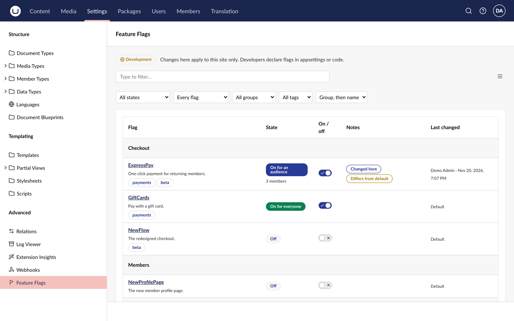
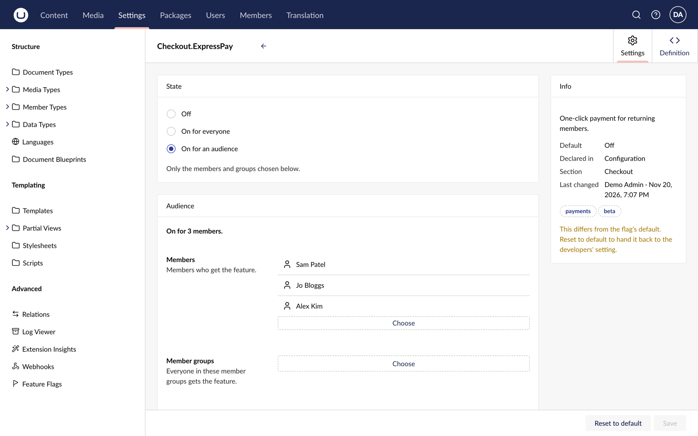

# Using the backoffice

For editors. Feature Flags lets you switch parts of the site on and off, for everyone or for chosen members, without
waiting for a deploy. Developers add the flags; you decide who gets each one.

A flag usually controls one part of a page, such as a new button, a different search box or a member price, rather
than a whole page. That is what makes it safe to try something with a few members before everyone sees it.

## Finding the flags

Go to **Settings** and choose **Feature Flags** under **Advanced** in the tree.



The tag at the top shows which environment you are on, such as Staging or Production. **Changes apply to this
environment only**: switching a flag on in staging doesn't switch it on on the live site.

Flags are listed in sections, such as Checkout, with a description under each. To find one:

- type in **Type to filter** to search names and descriptions;
- use the filters for state, section and tag;
- tick **Changed here**, **Differs from default** or **Declared twice** to see only flags with those notes; tick more
  than one to see flags with all of them;
- use **Show** to switch to undeclared flags;
- sort by section or by when they last changed;
- switch between a list and cards with the button at the top right.

The list shows 25 flags a page.

## What the list tells you

| | |
| --- | --- |
| **Off** | Nobody gets the feature. |
| **On for everyone** | Every visitor gets it, signed in or not. |
| **On for an audience** | Only the members and groups chosen, with how many under the state. |
| **On with conditions** | Only when the flag's conditions hold: an audience, or conditions the developers added. |
| **Custom** | The developers set the flag up in a way this screen can't change, such as a filter nobody registered a condition for. It can only be changed where it is declared. |
| **Changed here** | Someone changed the flag in this backoffice; the last column says who and when. |
| **Default** | Nobody has changed it here, so it is as the developers set it. |
| **Differs from default** | Its setting here is different from the developers' setting. |
| **Declared twice** | The developers declared the flag in two places. Worth telling them. |

## Switching a flag on or off

Use the switch in the list:

- **Turning a flag off** happens straight away.
- **Turning a flag on** first asks you to confirm, saying who it will be on for and on which environment.

Turning a flag off keeps who it was for, so turning it back on gives it to the same people again.

The site picks up a change within a few seconds, on every server.

## Choosing who a flag is for

Choose a flag's name to open it.



1. Under **State**, choose **Off**, **On for everyone** or **On with conditions**.
2. For conditions, choose **Add condition** and pick one from the menu. Each condition is a box of its own, with a
   remove button; add as many as you need. A condition already on the flag isn't offered again.
3. Choose **Save**. **Unsaved changes** shows at the top until you save, or until you undo your changes.

The condition every site has is **Audience**, which is on for chosen people:

- **Members:** particular people.
- **Member groups:** everyone in a member group. A member group the developers named in configuration is listed
  under the picker; remove it with its remove button.
- **Other groups:** groups the developers worked out in code, such as "Premium customers". Only shown when the site
  has some. A group the site no longer knows, such as a deleted member group or a group a provider stopped
  offering, is listed here too. It is kept as saved until you remove it.

Below the pickers:

- **…and this percentage of everyone else:** a share of the signed-in members who aren't already chosen.
- **How much of each group:** each chosen group has "N% of this group", 100% by default.
- **Except these members or groups:** picked the same way. They don't get the feature even when they are in a chosen
  group or the percentage.

Percentages count signed-in members only, and are sticky: the same members are in each time. See
[Audiences](audiences.md#percentages-and-exclusions).

A member gets the feature if they are in any of the chosen members or groups or in the percentage, and only while they are signed in.

Another condition every site has is **Time window**: "On from [date and time] until [date and time]". Either end can be
left empty, but not both, and the start must be before the end. You enter times in your browser's time zone; the UTC
equivalent is shown beside each, and times are stored as UTC. A window that repeats can be seen but not changed here.

**Only on these sites** limits a flag to the roots (top-level pages in the Content tree) you tick, each shown with its
domains. A site that has since been deleted shows as "a deleted site" with a Remove button. Adding it to a flag that
already has another condition switches the match to All. See [Conditions](conditions.md#root-only-on-these-sites-umbriciansroot)
for how a request's site is found.

Developers can add conditions of their own, such as "French visitors"; they appear in the same menu.

### Any or all of the conditions

With two or more conditions, **Match** appears. Choose **On when any one condition holds** (the default) or **On when
every condition holds**. When you add the **Site** condition to a flag that already has another condition, Match
switches to every condition and a note says so, because a flag meant for one site is almost always meant for that site
*and* its other conditions. You can change it back.

Turning a flag **Off** keeps its conditions. Choosing **On for everyone** and saving removes them.

### When a condition has no editor

A developer can register a condition in code without giving the backoffice a way to edit it. The flag shows it as
"This condition has no editor", with the flag's summary of what it does, and the flag can't be saved here, except by
choosing **On for everyone**, which replaces the conditions. Ask the developers to add an editor, or change the flag where
it is declared. A flag that uses a filter nobody registered at all is **Custom**, and is shown but never changed.

The **Info** panel shows the flag's description, its default, where it was declared and who last changed it. The
**Definition** tab shows the flag exactly as it is stored, for developers.

## Going back to the default

Open the flag and choose **Reset to default**, then confirm. Your setting is removed and the flag goes back to the
developers' setting, which the confirmation names.

## Undeclared flags

When the developers remove a flag that someone had changed here, its setting is left behind with no effect. The
**Show** filter lists these as **Undeclared flags**, with a count. Choose **Remove** to delete one; this can't be
undone.

## When you can't change anything

- **You can see flags but not change them:** your user group has **View feature flags** but not **Change feature
  flags**. Ask an administrator.
- **The list says flags can't be changed here:** the developers have set this site so flags are only changed in
  its configuration. Every flag uses its default, and Reset and Remove aren't offered either.
- **One flag can't be changed:** it is **Custom**, or has a condition with no editor. A box at the top of its editor says why.

## Extending the backoffice

For developers. Feature Flags promises a small part of its backoffice to your own extensions, and nothing else.

### What is promised

Within one Umbraco major version (all of 17.x), these keep working and are never renamed:

- the entity types `umbricians-feature-flags-flag` (one flag; its `unique` is the flag's name) and
  `umbricians-feature-flags-root` (the list);
- the aliases of the flag workspace (`Umbricians.FeatureFlags.Workspace.Flag`), the root workspace
  (`Umbricians.FeatureFlags.Workspace.Root`), the collection (`Umbricians.FeatureFlags.Collection`) and the menu item
  (`Umbricians.FeatureFlags.MenuItem.Root`);
- the permission condition `Umbricians.FeatureFlags.Condition.Permission`, whose `permission` is
  `Umbricians.FeatureFlags.View` or `Umbricians.FeatureFlags.Manage`, so your UI shows only to editors who may view
  or change flags;
- the `umbriciansFeatureFlagsCondition` manifest type and its element's contract: `value` in, a `change` event out
  (see [Conditions](conditions.md));
- the read-only flag workspace context, with the alias `Umbricians.FeatureFlags.FlagWorkspaceContext.Public`. Its
  `flag` is an observable of the flag, shaped like the Management API's flag. Changes never go through it: they go
  through conditions or the Management API;
- entity actions you register for the flag entity type, which show in the flag workspace's actions menu and on each
  flag in the list (table and card views).

Not promised: element tag names, repositories, the generated API client, the editor's state, the summary context and
the built-in collection and workspace views. There is no extension type for list columns: if you need a different
list, add a collection view to the promised collection.

**Why only within a major.** Umbraco's promise of no breaking changes in a minor release is about its C# API. Its
backoffice TypeScript has no such promise, and its own breaking changes have all come in majors so far. So this
surface is promised for an Umbraco major, not for every minor. A scheduled workflow
([Umbraco minors](../.github/workflows/umbraco-minors.yml)) builds and tests the package against the newest 17.x every
week to find a break early.

### The npm package

`@umbricians/feature-flags` has the types only, with `@umbraco-cms/backoffice` `^17.0.0` as a peer dependency.
It has no runtime code, so there are no constants to import: write the strings, or build a token from them. Where you
want a misspelt string to fail to compile, type it with the package's string literal aliases, such as
`FeatureFlagEntityType` (`"umbricians-feature-flags-flag"`).

```ts
import type { FeatureFlag, UmbriciansFeatureFlagWorkspaceContext } from "@umbricians/feature-flags";
```

### A workspace view that reads the flag

Register a workspace view for the flag workspace, and read the context with a token built from its alias:

```ts
// manifests
{
  type: "workspaceView",
  alias: "Contoso.WorkspaceView.FlagUsage",
  name: "Flag usage",
  element: () => import("./flag-usage.element.js"),
  weight: 50,
  meta: { label: "Usage", pathname: "usage", icon: "icon-search" },
  conditions: [
    { alias: "Umb.Condition.WorkspaceAlias", match: "Umbricians.FeatureFlags.Workspace.Flag" },
    { alias: "Umbricians.FeatureFlags.Condition.Permission", permission: "Umbricians.FeatureFlags.View" },
  ],
}
```

```ts
// flag-usage.element.ts
import { html, customElement, state } from "@umbraco-cms/backoffice/external/lit";
import { UmbLitElement } from "@umbraco-cms/backoffice/lit-element";
import { UmbContextToken } from "@umbraco-cms/backoffice/context-api";
import type { FeatureFlag, UmbriciansFeatureFlagWorkspaceContext } from "@umbricians/feature-flags";

const FLAG_CONTEXT = new UmbContextToken<UmbriciansFeatureFlagWorkspaceContext>("Umbricians.FeatureFlags.FlagWorkspaceContext.Public");

@customElement("contoso-flag-usage")
export class FlagUsageElement extends UmbLitElement {
  @state() private _flag?: FeatureFlag;

  constructor() {
    super();
    this.consumeContext(FLAG_CONTEXT, (context) => this.observe(context?.flag, (flag) => (this._flag = flag)));
  }

  override render() {
    return html`<uui-box>${this._flag?.name}: ${this._flag?.summary}</uui-box>`;
  }
}
export { FlagUsageElement as element };
```

### An entity action for flags

Register an ordinary Umbraco entity action for the flag entity type. It receives the flag's name as `unique`:

```ts
{
  type: "entityAction",
  kind: "default",
  alias: "Contoso.EntityAction.FlagUsage",
  name: "Show flag usage",
  forEntityTypes: ["umbricians-feature-flags-flag"],
  api: () => import("./show-usage.action.js"),
  meta: { icon: "icon-search", label: "Show usage" },
}
```

Its api extends Umbraco's `UmbEntityActionBase`; `this.args.unique` is the flag's name:

```ts
// show-usage.action.ts
import { UmbEntityActionBase } from "@umbraco-cms/backoffice/entity-action";
import { UMB_NOTIFICATION_CONTEXT } from "@umbraco-cms/backoffice/notification";

export class ShowUsageAction extends UmbEntityActionBase<never> {
  override async execute() {
    const notifications = await this.getContext(UMB_NOTIFICATION_CONTEXT);
    notifications?.peek("positive", { data: { headline: "Flag usage", message: this.args.unique! } });
  }
}
export { ShowUsageAction as api };
```

It appears in the actions menu in the flag's workspace header and on that flag's row or card in the list. Feature Flags
registers no entity actions of its own, so there is nothing to conflict with.

### A condition's editor

See [Conditions](conditions.md#writing-your-own) for the manifest type and the element's contract.
