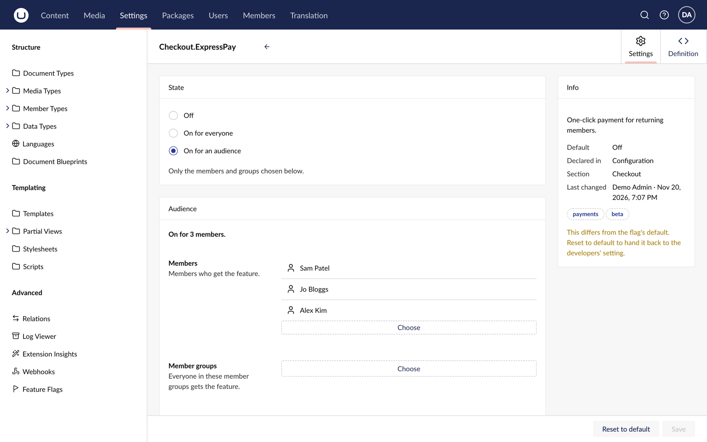

# Getting started

This guide takes you from installing Feature Flags to a flag that is on for a few members on one page of your site,
switched from the backoffice. It takes about ten minutes.

## Requirements

- Umbraco 17.8.0 or later.
- A developer to declare flags and check them in the site's code. Editors switch flags, but they can't create them.

## 1. Install the package

```bash
dotnet add package Umbricians.FeatureFlags
```

Restart the site. On first start the package:

- adds Microsoft.FeatureManagement, unless the site already uses it;
- adds one table to the database, `umbriciansFeatureFlagsOverride`, for editors' settings;
- gives the Administrators user group its two permissions.

Nothing else needs configuring.

## 2. Declare a flag

Add a flag to `appsettings.json` in Microsoft's `feature_management` section. Start it off:

```json
{
  "feature_management": {
    "feature_flags": [
      {
        "id": "Checkout.ExpressPay",
        "enabled": false,
        "description": "One-click payment for returning members."
      }
    ]
  }
}
```

The text before the first `.` is the flag's section in the backoffice, so this flag is listed under "Checkout". You can
declare flags in code instead; see [Declaring and checking flags](declaring-flags.md).

## 3. Check it in the site

Add Microsoft's tag helpers to `Views/_ViewImports.cshtml`:

```cshtml
@addTagHelper *, Microsoft.FeatureManagement.AspNetCore
```

Then wrap the part of the page the flag switches:

```cshtml
<feature name="Checkout.ExpressPay">
    <a class="button" href="/express-pay">Buy now with ExpressPay</a>
</feature>
```

Reload a page that uses it: the button isn't there, because the flag is off.

## 4. Switch it on in the backoffice

1. Go to **Settings**, and choose **Feature Flags** under Advanced in the tree.
2. Choose **ExpressPay** under Checkout.
3. Choose **On for an audience**, then **Choose** under Members and pick one or two members.
4. Choose **Save**.



Sign in on the front end as one of those members and the button appears; sign in as anyone else, or sign out, and it
doesn't. On a load-balanced site every server picks the change up within seconds.

To hand the flag back to the developers' setting, open it and choose **Reset to default**. The list's switch turns a
flag off at once, and asks first before turning one on. [Using the backoffice](backoffice.md) covers the rest of the
screens.

## 5. Give editors access

Administrators can already change flags. For anyone else, go to **Users → User groups**, open their group, and under
**Permissions → Feature Flags** tick **View feature flags**, and **Change feature flags** if they should change them.

## Before you go live

- [ ] Every flag that switches on unfinished work is declared `"enabled": false`, so a deploy never turns it on by
      itself.
- [ ] Audiences in appsettings name member groups, not members. A member's key is different in each environment's
      database, so choose individual members in each environment's backoffice.
- [ ] Each environment has its own settings: switching a flag on in staging doesn't switch it on in production.
- [ ] Only the user groups that should change flags on production have **Change feature flags**.
- [ ] If your flag source, such as Azure App Configuration, should stay in charge, set
      `Umbricians:FeatureFlags:Overrides` to `ReadOnly` (see the [README](../README.md#configuration)).
- [ ] The **Feature Flags** health check is green: go to **Settings → Health Check**, run the **Feature Flags** group,
      and fix any error or warning (each result is explained [below](#the-health-check)). The startup log says the same.
- [ ] Pages whose content changes per member aren't served from a shared cache, such as output caching or a CDN,
      or one member's version is shown to everyone.

## The health check

Settings → Health Check → Feature Flags checks the set-up and lists what is wrong. Errors and warnings name the flags
involved; info results only give a count. Nothing here has a button: fix it where the problem is. The startup log
reports every error and warning with the same words.

| Result | What it means and what to do |
| --- | --- |
| <a id="settings-cant-be-read"></a>**Error:** the saved settings can't be read | The store is failing, or the package's migration hasn't run. Flags use their defaults, or the settings read last. Run the site's upgrade and check the database. |
| <a id="feature-management-registered-twice"></a>**Error:** Microsoft.FeatureManagement is registered more than once | The site calls `AddFeatureManagement()` after Umbraco is added. Remove the call, or move it before Umbraco is added. |
| <a id="filters-share-a-name"></a>**Error:** more than one feature filter has the same name | Usually Microsoft's `WithTargeting<T>()` added after Umbraco. Move it before Umbraco is added, so Feature Flags replaces Microsoft's filter. |
| <a id="flag-source-registered-late"></a>**Error:** the flag source is registered after Feature Flags | A custom `IFeatureDefinitionProvider` was registered after Umbraco, so settings from the backoffice have no effect. Register it before Umbraco is added. |
| <a id="a-saved-setting-cant-be-read"></a>**Warning:** a saved setting can't be read | The named flags use their defaults. Open each in the backoffice and save it again, or reset it. |
| <a id="a-definition-cant-be-read"></a>**Warning:** a declared flag's definition can't be read | Checking the named flags fails. Fix their declaration in appsettings or in the flag source. |
| <a id="the-flag-source-cant-list-its-flags"></a>**Warning:** the flag source can't list its flags | The backoffice shows only the flags it could read one by one. Check the flag source, such as Azure App Configuration. |
| <a id="a-group-provider-fails"></a>**Warning:** a group provider fails to list its groups | The editor offers none of that provider's groups. It is given five seconds to answer. Check what the provider depends on. |
| <a id="a-flag-is-declared-twice"></a>**Warning:** a flag is declared both in code and by the flag source | The flag source's declaration is used. Remove one of the two. |
| <a id="a-root-condition-names-a-deleted-root"></a>**Warning:** a Root condition names a deleted root | Choose another root for the named flags, or remove the condition. |
| <a id="headless-is-on-but-no-flag-is-public"></a>**Warning:** the headless endpoint is on but no flag is public | `Headless:Enabled` is true, so [the headless endpoint](headless.md) answers, but it has nothing to say. Mark flags public. |
| <a id="undeclared-flags"></a>**Info:** undeclared flags are waiting to be removed | Settings are saved for flags nobody declares any more. Remove them from the list's Undeclared flags filter. |
| <a id="overrides-are-read-only"></a>**Info:** overrides are read-only | `Overrides` is `ReadOnly`, so the backoffice can't change flags. That's expected if your flag source is in charge. |
| <a id="flags-with-a-custom-state"></a>**Info:** flags are in a custom state | The backoffice can't edit them; change them where they are declared. |
| <a id="the-health-check-cant-run-a-check"></a>**Warning:** Feature Flags couldn't check something | One part of the check threw. The log has the details; the other results are still shown. |
| <a id="everything-is-fine"></a>**Success:** everything is fine | No errors or warnings. |

## Troubleshooting

| Symptom | Cause | Fix |
| --- | --- | --- |
| A flag isn't in the backoffice list. | Nothing declares it, or the site was not restarted after it was added. | Declare it in appsettings or code and restart. Flags can't be added in the backoffice. |
| A saved change makes no difference on the site. | The page is cached, the site checks a different flag name, or `Overrides` is `ReadOnly`. | Check the name matches exactly, and that the page isn't served from a cache. A read-only site says so at the top of the list. |
| A flag is on for an audience, but a member in it doesn't get the feature. | They aren't signed in as a member, or they're in the audience by a group the site's group provider doesn't put them in. | Sign in on the front end, not only in the backoffice: backoffice users aren't members. |
| A flag shows **Custom** and can't be edited. | Its definition uses something the backoffice has no screen for yet, such as a time window, a percentage or variants. | Change it where it is declared. Saving never drops these parts. |
| A flag shows **Declared twice**. | Code and configuration both declare it. Configuration's declaration is used. | Remove one of the two. |
| The list has **Undeclared flags**. | An editor changed a flag that the developers have since removed. Its setting has no effect. | Open the list's Show filter, choose Undeclared flags, and remove them. |
| The startup log says Microsoft.FeatureManagement is registered more than once. | The site calls `AddFeatureManagement()` after Umbraco is added. Checking a flag with a time window then throws. | Remove the call, or move it before Umbraco is added so Feature Flags uses it. |
| The startup log says the site registered its own flag source after Feature Flags. | A custom `IFeatureDefinitionProvider` was registered after Umbraco, so editors' settings don't apply. | Register it before Umbraco is added. |
| A member group named in appsettings shows as "1 other group" in the editor. | Audiences in appsettings can name a member group by name; the backoffice picker works with groups by key. The flag still works on the site. | Choose the group again in the backoffice if editors should manage it there. |
